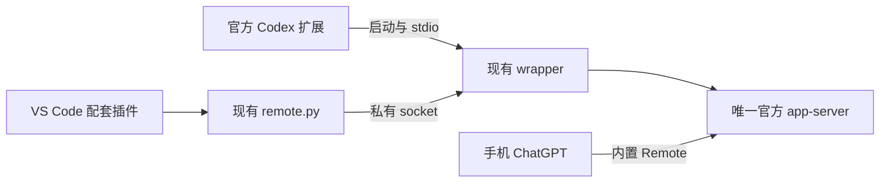

# 实现介质考查 — 2026-10-05

## 结论

**后续产品主入口建议开发为 VS Code 配套插件，以 VSIX 交付；现有 Python wrapper/CLI 作为随插件交付的本地运行组件保留。** 手机端继续使用 ChatGPT 内置 Remote。

Phase K 考查时项目是可工作的独立 CLI 工具。用户随后要求继续 Phase L，现已创建最小 JavaScript 配套插件，正在完成 VSIX 交付和新增层验收；当前状态以 task_plan.md 为准。

这是根据现有代码、已经完成的人工验收和 VS Code 官方能力作出的工程判断：用户的操作入口、项目和原 Codex owner 都在 VS Code，新增产品界面放在这里最直接。

## 现有实现检查

| 组件 | 已有职责 | 后续处理 |
|---|---|---|
| `wrapper/codex-wrapper` | 被官方扩展作为 cliExecutable 启动；保持原 stdio/环境/目录，启动原 app-server | 保留透传与生命周期逻辑 |
| `wrapper/control.py` | 私有 Unix socket、请求 ID 隔离、加载聊天范围及 Remote allowlist | 保留协议路由，不重新实现 |
| `scripts/remote.py` | 按项目/唯一 writer 选择，connect/pair/status/disconnect，结构化输出 | 插件通过此入口调用，CLI继续可单独使用 |
| Python 配对页 | 私有手动码、可选 QR、打开浏览器 | 复用现有产物，无须新建 Webview |
| 官方 app-server 内置 Remote | 手机身份认证、聊天控制、审批及桌面同步 | 继续承担手机端控制 |

wrapper 在官方扩展启动 app-server 时接入。独立桌面程序也不能直接接管一个已经建立的 stdio 通道，仍需配置和部署同一 wrapper，因此独立 GUI 无法省去核心接入步骤。

本机官方扩展26.930.51102的 `package.json` 显示：`chatgpt.cliExecutable` 是 application/restricted 设置，描述标记 DEVELOPMENT ONLY。当前 `activate` 实现不返回 app-server 控制 API，注册的公开 commands 中没有 Remote enable/pairing。因此，配套插件负责调用已验证的本地桥，不依赖一个并不存在的公开 Remote command，也不修改官方扩展源码。

## 形态比较

| 形态 | 适合的用途 | 当前判断 |
|---|---|---|
| 独立 CLI | 终端使用、排错、脚本调用 | 已交付，作为运行核心和备用入口保留 |
| 独立桌面程序 | 将来跨 IDE 管理多个客户端 | 当前没有该需求；另做界面、窗口选择和安装生命周期会增加工作 |
| VS Code 配套插件 | 获取当前工作区，一处完成连接/配对/状态/断开 | **推荐作为后续主交付** |
| ChatGPT/MCP 插件 | 自定义手机控制面 | 内置 Remote 已通过验收，Phase F 已替代 |

VS Code API 已提供工作区、Quick Pick、命令注册和状态栏；无需另做项目管理界面。[VS Code API](https://code.visualstudio.com/api/references/vscode-api)

VSIX 可以直接安装和分发，第一版采用本地包即可。[官方打包文档](https://code.visualstudio.com/api/working-with-extensions/publishing-extension)

## 最小插件职责

1. **启用/恢复接入：** 检测官方扩展、定位对应 Codex binary、部署受管理的 wrapper/config；备份并通过配置 API 更新 cliExecutable。提供恢复原配置命令，提示在空闲时重载。
2. **连接当前项目：** 从 VS Code 工作区取得目标；多根工作区或多 owner 时用 Quick Pick 明确选择，再调用现有 CLI。
3. **配对手机：** 调用原 pairing 入口并打开已有私有页面，沿用手动码/可选 QR。
4. **状态/断开：** 提供命令和一个状态栏项，使用原 owner 的 status/disconnect；不因为插件激活就自动连接或切换另一窗口。

插件使用 JavaScript、VS Code 原生 API 和 Node 内置子进程能力即可。调用 Python CLI 使用参数数组及结构化 JSON 输出，保留已有失败处理，不重新发送结果未知的写请求。

第一版只提供命令、Quick Pick、状态栏及配置恢复；连接功能不需要新侧栏、聊天界面、HTTP 服务、数据库或常驻独立程序。

## Windows / WSL 落点

建议声明为 Node workspace extension：`extensionKind: ["workspace"]`。Remote-WSL 窗口中，插件在 WSL 端执行 Python CLI，访问同端 socket；workspace 插件也能提供命令和 UI。[官方宿主说明](https://code.visualstudio.com/api/advanced-topics/remote-extensions)

| 已验证使用方式 | 配套插件所在侧 | Python wrapper/CLI 所在侧 | 调用路径 |
|---|---|---|---|
| Windows 本地窗口 + WSL Codex | Windows Extension Host | 官方 Codex 实际使用的 WSL 发行版 | Node → wsl.exe → Python CLI → socket |
| Remote-WSL 窗口 | WSL Extension Host | 同一 WSL 发行版 | Node → Python CLI → socket |

Windows 本地调用必须明确使用与官方 Codex 相同的 WSL 发行版，并转换项目/资源路径；不能把 Windows 路径直接当成 thread.cwd，也不能假设默认发行版就是实际 owner 所在处。Remote-WSL 则直接使用 Linux 路径。

VS Code 原生 API 能跨宿主工作，Node 文件/进程操作不会自动转发到另一侧；实现时按上述两条路径分别落地。[Extension Host 文档](https://code.visualstudio.com/api/advanced-topics/extension-host)

VSIX 中携带已有 Python 组件；运行配置和被 cliExecutable 指向的 launcher 使用稳定的受管理路径，凭据/配对产物继续放 WSL 私有 state。部署脚本将资源按原目录结构复制到稳定路径，沿用原配置定位，不重写协议与 owner 判断。

首版继续支持已经验收的 Windows+WSL / Remote-WSL 组合。Windows 完全原生执行是单独可选事项，不由“做成插件”自动获得。

## 依赖边界和下一阶段

两种产品介质都会依赖现有 cliExecutable 调试接入点及 experimental Remote 协议。插件改善安装和使用方式，不把这条路径变成官方承诺稳定的扩展 API。首版围绕已验证版本打包，实际升级时再检查 binary 路径与相关协议。

**Phase L — 最小 VS Code 配套插件（in_progress）：**

1. 用一个轻量 Node 插件工程包装现有 CLI，补齐两种 Windows/WSL 调用路径和稳定配置定位。
2. 完成上述接入、连接、配对、状态、断开/恢复命令和状态栏。
3. 只检查新增插件的项目选择、命令参数、宿主侧、配置恢复和 VSIX安装；保留 H/J 人工验收，不重新跑完整手机功能测试。
4. 交付本地 VSIX 和安装/恢复说明。恢复接入命令先还原配置，必要重载后再卸载插件；不把普通 deactivate 当作卸载通知。

Phase K 已完成；现有 CLI 仍可继续使用。Phase L 已按上述范围启动，本地打包、安装及必要 UI 验收状态见 task_plan.md。
